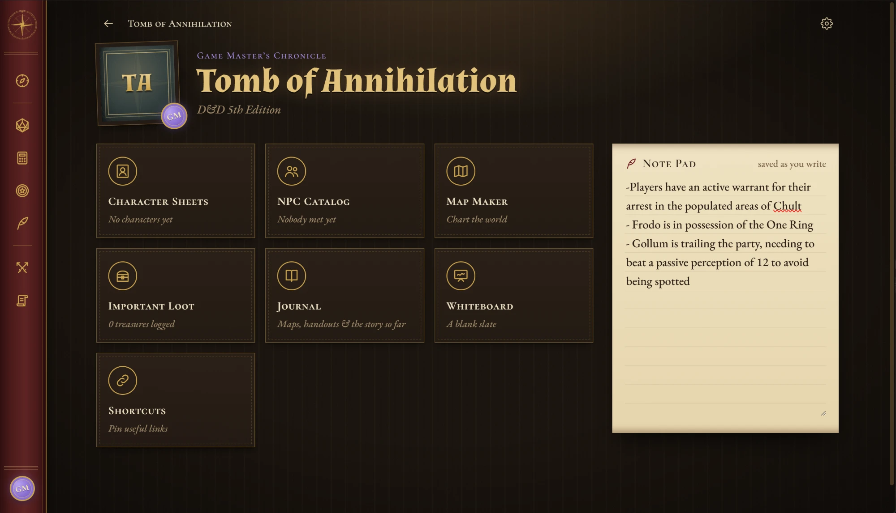

# Archmage

**The Ultimate TTRPG Campaign Manager**: a local, single-user desktop app for running and playing tabletop RPG campaigns.

## Download

Grab the latest **`Archmage Setup x.y.z.exe`** from the [Releases](../../releases/latest) page and run it.

Once installed, Archmage updates itself: new versions download in the background and install when you restart the app.

> Windows may show "Windows protected your PC" the first time, because the installer isn't code-signed yet. Choose **More info → Run anyway**.

This repository only hosts release downloads.
